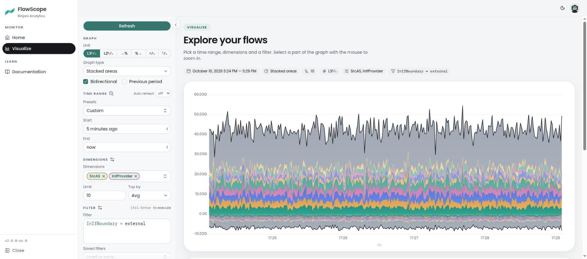
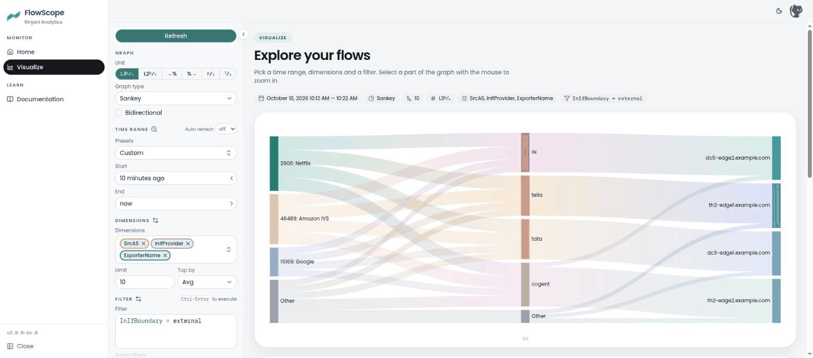
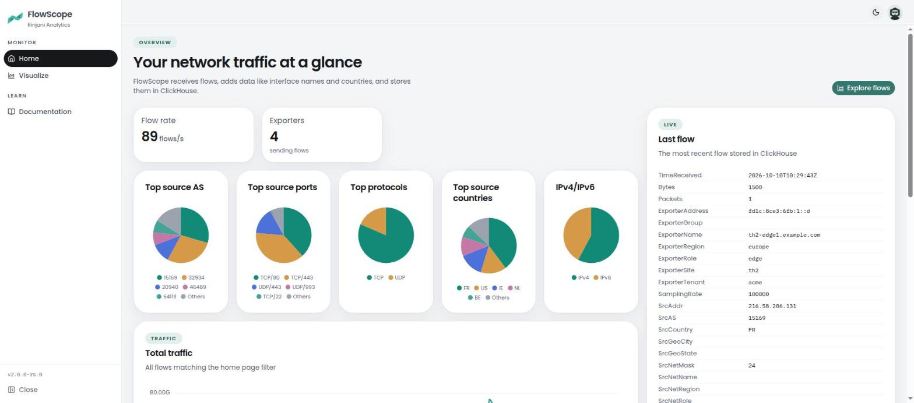
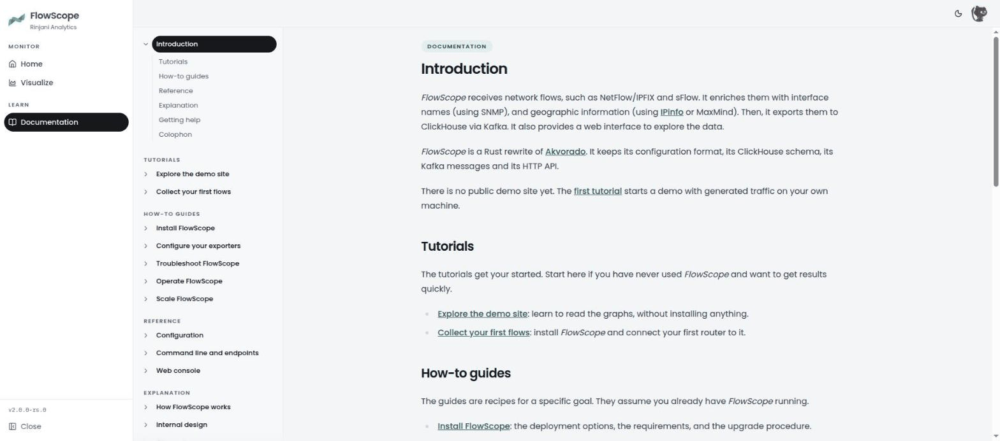

# FlowScope: flow collector, enricher and visualizer

**FlowScope is a Rust rewrite of [Akvorado](https://github.com/akvorado/akvorado).**
Akvorado is open source software written in Go and developed by Free Mobile.
It is the origin of this project and its inspiration: the design, the data
model and the documentation come from it. FlowScope is built by Rinjani
Analytics and is not affiliated with Akvorado or Free Mobile.

FlowScope receives network flows (NetFlow v5/v9, IPFIX and sFlow), enriches
them with interface names (SNMP or gNMI), routing information (BMP or BioRIS)
and geographic information, and stores them in ClickHouse through Kafka. A web
console lets you explore the collected flows.







The screenshots come from the demo setup below, with generated traffic.

## Try it

With Docker and Docker Compose, this starts FlowScope with four simulated
routers sending traffic:

```console
$ COMPOSE_PROFILES=demo docker compose up --wait
```

The first start builds the image. Then open `http://127.0.0.1:8081`.

## Documentation

The documentation is in [`docs/`](docs/00-intro.md). It ships with FlowScope:
the running console serves the version you use, under "Documentation".

[](docs/00-intro.md)

It is organized in four parts: tutorials to get started, how-to guides for a
specific goal, the reference, and explanations of the design.

> [!CAUTION]
> Read the [changelog](docs/99-changelog.md) before you upgrade.

## Build

FlowScope needs Rust (see `rust-toolchain.toml`), CMake and a C compiler for
the Kafka client, and Node.js with pnpm for the web interface.

```console
$ cd web && pnpm install && pnpm build && cd ..
$ cargo build --release
$ target/release/flowscope version
```

The `flowscope` binary runs every service: `flowscope orchestrator`,
`flowscope inlet`, `flowscope outlet`, `flowscope console` and
`flowscope demo-exporter`, each with a configuration file or the URL of the
orchestrator.

## Moving from Akvorado

FlowScope reads the configuration files of Akvorado, uses the same ClickHouse
tables and dictionaries, the same Kafka topics and messages, and the same HTTP
API. A deployment can move one service at a time. Three names differ:

- metrics are prefixed with `flowscope_` instead of `akvorado_`: dashboards
  and alerts need the new prefix,
- configuration overrides are `FLOWSCOPE_CFG_*` environment variables. The
  `AKVORADO_CFG_*` ones are refused at start: rename them,
- the outlet uses the `flowscope-outlet` Kafka consumer group. Set
  `kafka.consumer-group` to `akvorado-outlet` to resume from the offsets of an
  Akvorado outlet.

## Repository layout

- `crates/`: the Rust workspace (`flowscope` binary and `flowscope-*`
  libraries, including the `flowscope-sdk` client library). The packages
  carry the `rinjani-` prefix, as in `rinjani-flowscope-sdk`,
- `web/`: the web interface, embedded in the binary once built,
- `docs/`: the documentation, served by the console,
- `config/`: the configuration of the Docker Compose setup,
- `docker/`: the Dockerfile and the Docker Compose files,
- `tests/`: test data, and the answers recorded from Akvorado that FlowScope
  is checked against.

## License

FlowScope is licensed under the [AGPLv3 license](LICENSE.txt), like Akvorado.

## Credits

FlowScope would not exist without [Akvorado](https://github.com/akvorado/akvorado)
and its authors. The Rust code was written by porting Akvorado module by
module and checking each one against it. The files ported from Akvorado keep
the copyright notice of Free Mobile. The history of this repository starts
with the history of Akvorado.
